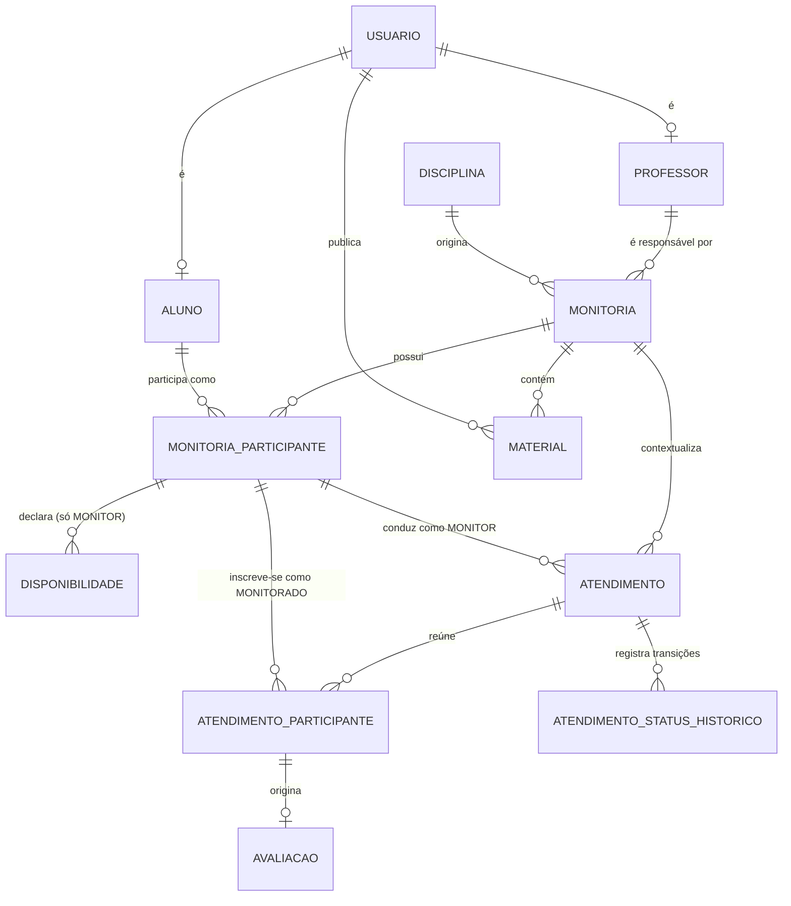

# Arquitetura e Modelagem — Plataforma de Apoio à Monitoria

> Documento de projeto e referência de implementação. Backend: NestJS + TypeScript + PostgreSQL + Sequelize.
> Status: **implementado**, salvo o que esta marcado como *projetado* nas seções 12 e 13.
>
> **Como ler este documento:** ele acumula o registro arquitetural do TCC, incluindo
> decisões que foram desenhadas e deliberadamente **não** implementadas. Elas são
> parte do raciocínio e ficam marcadas como 🔵 *projetado*; o que está no código
> aparece sem marca. Nada foi apagado — a decisão de não construir algo é tão
> parte do projeto quanto a de construir.
>
> **Revisão 3** — o núcleo funcional foi implementado. Duas mudanças em relação à
> revisão anterior, ambas por decisão explícita na especificação das fases 2 e 3:
> o ciclo do atendimento passou a ser **AGENDADO → REALIZADO / CANCELADO** (a etapa
> de confirmação prevista em D-08 deixou de existir), e entrou a entidade
> **ATENDIMENTO_STATUS_HISTORICO**, que não existia no desenho original.
>
> **Revisão 2** — incorpora as decisões: atendimento **em grupo** (D-03), disponibilidade por
> **recorrência semanal** (D-04), material com **upload de arquivo** em **disco local**
> (D-05, D-19) e agendamento iniciado por **aluno ou monitor** (D-08).

---

## 1. Análise do domínio

### 1.1 O núcleo

O agregado central é **MONITORIA**: a oferta organizada de apoio acadêmico de uma
*disciplina* em um *período*, sob responsabilidade de um *professor*.

Praticamente todas as regras de negócio (RN01–RN09) são regras **de contexto de monitoria**:
quem pode agir depende de *qual papel a pessoa tem naquela monitoria*, não de quem ela é
globalmente. Isso tem duas consequências diretas:

1. A autorização do sistema é **contextual** (baseada em participação), não apenas por perfil global.
2. `MONITORIA_PARTICIPANTE` não é uma tabela de junção acessória — é a entidade que
   materializa o vínculo e a habilitação. É o segundo cidadão mais importante do modelo.

### 1.2 A distinção fundamental: identidade x papel

| Conceito | Natureza | Onde vive |
|---|---|---|
| PROFESSOR / ALUNO | **identidade** — o que a pessoa *é* na instituição | `usuarios` + `professores` / `alunos` |
| MONITOR / MONITORADO | **papel contextual** — o que o aluno *faz* dentro de uma monitoria | `monitoria_participantes.papel` |

Modelar MONITOR/MONITORADO como tipo de usuário (herança, coluna `tipo` em `usuarios`,
tabelas `monitores`/`monitorados`) é o erro clássico deste domínio: quebra o exemplo do
enunciado (João é MONITOR em Cálculo I e MONITORADO em Banco de Dados) e torna
impossível representar história (RN10). Detalhamento na seção 9.

### 1.3 "Habilitação" não é uma entidade nova

RN01 e RN02 falam em *habilitar aluno como monitor para a disciplina/monitoria*.
Isso já é exatamente a semântica de criar um registro em `monitoria_participantes`
com `papel = MONITOR`, criado pelo professor responsável pela monitoria.

Como a monitoria já aponta para a disciplina, **RN02 é satisfeita estruturalmente**:
não existe forma de um monitor estar habilitado "na disciplina errada", porque o vínculo
é com a monitoria, e a monitoria tem exatamente uma disciplina.

Criar uma entidade `HABILITACAO` separada seria overengineering — só se justificaria se
existisse habilitação **fora** do contexto de uma monitoria (ex.: banco de monitores
elegíveis por disciplina, reaproveitável entre períodos). Ver seção 13, ponto D-06.

### 1.4 Atendimento em grupo: consequências

A decisão de permitir vários monitorados por atendimento (D-03) **não é uma mudança
cosmética**. Ela altera três coisas:

1. `ATENDIMENTO` deixa de apontar para um monitorado e passa a ter uma **entidade de
   inscrição** (`ATENDIMENTO_PARTICIPANTE`). O atendimento vira uma *sessão*; o aluno vira
   um *inscrito*.
2. **RN03 se divide em duas garantias com mecanismos diferentes**: o conflito do *monitor*
   continua sendo resolvido dentro de `atendimentos`; o conflito do *aluno* migra para a
   tabela de inscrições (seção 7.2).
3. Surge o conceito de **capacidade** (`vagas`) e de **presença** — porque em grupo faz
   diferença quem efetivamente compareceu, e RN06 depende disso.

Um efeito colateral positivo: atendimento individual continua representável — é uma sessão
com `vagas = 1`. Não há dois caminhos de código.

### 1.5 Escopo consciente

O sistema **não** é um sistema acadêmico institucional. Não modela: matrícula em disciplina,
turmas, histórico escolar, notas oficiais, grade curricular. `DISCIPLINA` aqui é apenas um
catálogo mínimo para dar nome e código à monitoria.

---

## 2. Arquitetura proposta

### 2.1 Estilo

**Monólito modular em camadas**, orientado a módulos NestJS por contexto de domínio.

Não adotar (para este escopo): CQRS, Event Sourcing, arquitetura hexagonal completa com
ports/adapters, camada de repositório abstrata genérica, DDD tático completo
(Value Objects, Aggregates com invariantes em memória). Todos aumentam a superfície de
código sem resolver nenhum problema real do domínio e prejudicam a defesa do TCC.

🔵 *Projetado, não implementado:* o **`StorageService`** seria a única abstração de
infraestrutura — uma classe fina isolando as chamadas de sistema de arquivos do serviço de
domínio, com implementação única em disco local (D-19). Como o upload de materiais ficou
fora de escopo, ele não existe no código; `MateriaisService` trabalha apenas com links e
não toca em `fs`. O desenho fica registrado para quando o upload for construído (§7.4).

A única dependência de infraestrutura efetivamente adicionada foi o **barramento de
eventos em processo** (`@nestjs/event-emitter`), que desacopla a gamificação do núcleo.

### 2.2 Camadas por módulo

```
HTTP → Controller → Service → Model (Sequelize) → PostgreSQL
        (DTO +       (regras de   (persistência)
      validação)      negócio)
```

- **Controller**: rota, DTO de entrada/saída, guards. Zero regra de negócio.
- **Service**: dono das regras. Onde RN01–RN09 são verificadas.
- **Model (`sequelize-typescript`)**: mapeamento e associações. Injetado direto no service
  via `@InjectModel`. Sem camada `Repository` extra enquanto houver um único consumidor.
- **Guards/Policies**: autorização em duas camadas — perfil global (`ALUNO`/`PROFESSOR`) e
  **participação** (é participante ativo desta monitoria? com qual papel?).

### 2.3 Princípio de integridade: banco como última linha de defesa

Regras que podem ser expressas como constraint **devem** existir no banco, além da
validação no service. Motivo: concorrência. Duas requisições simultâneas de agendamento
passam pelo `SELECT` de verificação e ambas inserem — só uma constraint impede o conflito
de horário (RN03). PostgreSQL tem exatamente a ferramenta para isso (`EXCLUDE` + `btree_gist`).

O mesmo raciocínio vale para **capacidade** (`vagas`): duas inscrições simultâneas na última
vaga passam pelo mesmo `COUNT`. Como capacidade não é expressável como constraint
declarativa, a garantia vem de `SELECT ... FOR UPDATE` na linha do atendimento dentro da
transação de inscrição (seção 7.3).

### 2.4 Autenticação

JWT stateless, sem refresh token (**D-09 decidida**: TTL de 8h, cobrindo uma jornada de
trabalho; o cliente trata o 401 preservando o rascunho). O custo de um token viver mais é
atenuado pela `JwtStrategy`, que recarrega o usuário do banco a cada requisição —
desativar uma conta tem efeito imediato, independentemente do TTL. 🔵 *Projetado para
produção:* refresh token rotativo com tabela de sessões e revogação.

`perfil` e `usuarioId` no payload; a **participação em monitoria nunca vai no token** —
é consultada por requisição, porque muda e é o eixo de autorização sensível.

**Não há auto-cadastro** (AD-13). Nenhuma identidade nasce de uma requisição
anônima: criar conta, de aluno ou de professor, exige um professor autenticado
(`POST /api/alunos`, `POST /api/professores`).

A superfície pública da API são quatro rotas: `GET /api/configuracao`,
`POST /api/auth/login` e as duas de recuperação de senha (AD-14). Nenhuma delas
cria conta — as de recuperação operam sobre conta existente, e só por meio de um
código entregue no e-mail dela.

Isso reposiciona a RN01. Enquanto o auto-cadastro existia, qualquer pessoa com
acesso à rede podia tornar-se PROFESSOR e, daí, habilitar monitores; a barreira
era um código compartilhado no ambiente (`CODIGO_CADASTRO_PROFESSOR`), que
circulava por fora do sistema, não identificava ninguém e não deixava rastro.
A barreira atual é nominal: quem cria uma conta está autenticado, e sua autoria
fica em `usuarios.criado_por_usuario_id`.

A contrapartida é o **bootstrap**: o primeiro professor não pode ter sido criado
por outro, e a API deliberadamente não oferece caminho para ele. Ele é criado
fora da aplicação, por um script que exige credenciais do PostgreSQL
(`npm run criar-professor`). Trocou-se uma rota pública permanente por uma
operação administrativa pontual — e `criado_por_usuario_id` nulo passa a
identificar exatamente as contas de bootstrap.

---

## 3. Modelo conceitual



Leitura do núcleo: `ALUNO` e `MONITORIA` têm relação **N:M com atributos**
(`papel`, `status`, datas), resolvida pela entidade associativa `MONITORIA_PARTICIPANTE`,
que por sua vez vira o **sujeito** de disponibilidades, atendimentos e inscrições.

Repare que existem **duas** entidades associativas encadeadas — `MONITORIA_PARTICIPANTE`
(aluno ↔ monitoria) e `ATENDIMENTO_PARTICIPANTE` (participante ↔ sessão). Isso não é
redundância: a primeira representa vínculo com o programa, a segunda representa presença
em um encontro específico.

---

## 4. Entidades

Convenções: PK `uuid`; `created_at`/`updated_at` em todas; timestamps com timezone
(`TIMESTAMPTZ`); enums como `VARCHAR` + `CHECK` (ver D-11); nomes de tabela em `snake_case` plural.

### 4.1 `usuarios`
| Coluna | Tipo | Notas |
|---|---|---|
| `id` | uuid PK | |
| `nome` | varchar(150) NOT NULL | |
| `email` | citext UNIQUE NOT NULL | institucional |
| `senha_hash` | varchar NOT NULL | argon2/bcrypt |
| `ativo` | boolean NOT NULL default true | desativação lógica (RN10) |

Sem coluna `tipo`: o perfil é derivado da existência de `alunos`/`professores`.

### 4.2 `alunos`
| Coluna | Tipo | Notas |
|---|---|---|
| `usuario_id` | uuid PK/FK → usuarios | 1:1 |
| `matricula` | varchar(30) UNIQUE NOT NULL | |
| `curso` | varchar(120) NULL | |

### 4.3 `professores`
| Coluna | Tipo | Notas |
|---|---|---|
| `usuario_id` | uuid PK/FK → usuarios | 1:1 |
| `identificacao_funcional` | varchar(30) UNIQUE NULL | SIAPE/matrícula |
| `departamento` | varchar(120) NULL | |

### 4.3b `cursos`
| Coluna | Tipo | Notas |
|---|---|---|
| `id` | uuid PK | |
| `codigo` | citext UNIQUE NOT NULL | **gerado** a partir do nome (ENG001). Imutável |
| `nome` | varchar(150) NOT NULL | |
| `ativo` | boolean NOT NULL default true | sem `DELETE` (RN10) |

Topo da cadeia de elegibilidade. A disciplina se liga ao curso por
`disciplina_cursos` (N:M — a mesma disciplina serve vários cursos), o aluno por
`alunos.curso_id`, e as FKs compostas exigem que o curso do aluno esteja entre
os da disciplina para haver participação (AD-22).

### 4.3c `disciplina_cursos`
| Coluna | Tipo | Notas |
|---|---|---|
| `disciplina_id` | uuid, parte da PK | FK → disciplinas |
| `curso_id` | uuid, parte da PK | FK → cursos |

A PK composta não é só chave técnica: é o **alvo** da FK
`fk_participante_disciplina_curso`, que sustenta a regra de elegibilidade.

### 4.4 `disciplinas`
| Coluna | Tipo | Notas |
|---|---|---|
| `id` | uuid PK | |
| — | — | o curso **não** é coluna: a relação é N:M, em `disciplina_cursos` |
| `codigo` | citext UNIQUE NOT NULL | **gerado** a partir do nome: prefixo + sequência (CAL001). Imutável. Ver AD-16 |
| `nome` | varchar(150) NOT NULL | |
| `ativa` | boolean NOT NULL default true | |

### 4.5 `monitorias`
| Coluna | Tipo | Notas |
|---|---|---|
| `id` | uuid PK | |
| `disciplina_id` | uuid FK NOT NULL | RESTRICT |
| `professor_id` | uuid FK → professores NOT NULL | responsável |
| `ano` | smallint NOT NULL | CHECK entre 2000 e 2100 |
| `semestre` | smallint NOT NULL | CHECK IN (1,2) |
| `descricao` | text NULL | |
| `edital_id` | uuid NULL | FK → editais. PROCEDENCIA: preenchido so pela aprovacao de candidatura. Nulo = criada a mao, que segue sendo o caminho normal |
| `status` | varchar NOT NULL | `StatusMonitoria` |
| `data_inicio` / `data_fim` | date NULL | vigência real |

`UNIQUE (disciplina_id, professor_id, ano, semestre)` — ver D-02.

### 4.6 `monitoria_participantes` — **entidade-chave**
| Coluna | Tipo | Notas |
|---|---|---|
| `id` | uuid PK | |
| `monitoria_id` | uuid FK NOT NULL | |
| `aluno_id` | uuid FK → alunos NOT NULL | |
| `papel` | varchar NOT NULL | `MONITOR` \| `MONITORADO` |
| `status` | varchar NOT NULL | `ATIVO` \| `ENCERRADO` |
| `ingressou_em` | timestamptz NOT NULL | |
| `encerrado_em` | timestamptz NULL | preenchido ao sair (RN10) |
| `habilitado_por_usuario_id` | uuid FK → usuarios NULL | rastro de RN01 |

- `UNIQUE (monitoria_id, aluno_id) WHERE status = 'ATIVO'` → RN09.
- `UNIQUE (id, monitoria_id)` → alvo de FK composta em `atendimentos` e em
  `atendimento_participantes`.

### 4.7 `disponibilidades`
| Coluna | Tipo | Notas |
|---|---|---|
| `id` | uuid PK | |
| `participante_id` | uuid FK → monitoria_participantes NOT NULL | deve ter `papel = MONITOR` |
| `dia_semana` | smallint NOT NULL | 0=domingo … 6=sábado |
| `hora_inicio` / `hora_fim` | time NOT NULL | CHECK `hora_fim > hora_inicio` |
| `ativa` | boolean NOT NULL default true | histórico preservado (RN10) |

Semântica: **recorrência semanal declarada**, não slots concretos. A disponibilidade é
*vitrine* (o aluno vê quando o monitor costuma atender) e *validação* (solicitação fora da
faixa é rejeitada); as ocorrências concretas são sempre `atendimentos` (D-04, decidido).

### 4.8 `atendimentos` — a *sessão*

> Não há coluna de duração, e isso é decisão registrada (AD-30): `inicio` e `fim`
> são NOT NULL com `CHECK (fim > inicio)`, e `ex_monitor_sem_conflito` impede
> sobreposição entre atendimentos contáveis do mesmo monitor. A carga horária é
> somada na leitura, sem risco de duração indefinida, negativa ou contada em dobro.
| Coluna | Tipo | Notas |
|---|---|---|
| `id` | uuid PK | |
| `monitoria_id` | uuid FK NOT NULL | |
| `monitor_participante_id` | uuid NOT NULL | participante com `papel = MONITOR` |
| `inicio` / `fim` | timestamptz NOT NULL | CHECK `fim > inicio` |
| `vagas` | smallint NOT NULL default 1 | CHECK `vagas >= 1`; `1` = atendimento individual |
| `modalidade` | varchar NOT NULL | `PRESENCIAL` \| `REMOTO` |
| `local` | varchar(150) NULL | sala ou link |
| `assunto` | varchar(200) NOT NULL | |
| `status` | varchar NOT NULL | `StatusAtendimento` |
| `origem` | varchar NOT NULL | `SOLICITACAO_ALUNO` \| `OFERTA_MONITOR` (D-08) |
| `criado_por_usuario_id` | uuid FK → usuarios NOT NULL | quem iniciou |
| `motivo_cancelamento` | text NULL | |

- `UNIQUE (id, monitoria_id, inicio, fim)` → alvo da FK composta das inscrições (seção 7.2).
- Não há `monitorado_participante_id`: os monitorados vivem em `atendimento_participantes`.

### 4.9 `atendimento_participantes` — a *inscrição*
| Coluna | Tipo | Notas |
|---|---|---|
| `id` | uuid PK | |
| `atendimento_id` | uuid NOT NULL | |
| `monitoria_id` | uuid NOT NULL | denormalizado — garante RN04 via FK composta |
| `participante_id` | uuid NOT NULL | participante com `papel = MONITORADO` |
| `inicio` / `fim` | timestamptz NOT NULL | denormalizados do atendimento, mantidos por `ON UPDATE CASCADE` |
| `status` | varchar NOT NULL | `StatusInscricao` |
| `inscrito_em` | timestamptz NOT NULL | |
| `inscrito_por_usuario_id` | uuid FK → usuarios NOT NULL | o próprio aluno ou o monitor |

- `UNIQUE (atendimento_id, participante_id)` — não dá para se inscrever duas vezes.
- A denormalização de `inicio`/`fim` **não é redundância preguiçosa**: é o que torna
  possível a constraint `EXCLUDE` de RN03 para o aluno (seção 7.2), e ela é mantida
  consistente pelo próprio banco, não por código.

### 4.10 `avaliacoes`
| Coluna | Tipo | Notas |
|---|---|---|
| `id` | uuid PK | |
| `atendimento_participante_id` | uuid FK UNIQUE NOT NULL | **a inscrição**, não o atendimento |
| `nota` | smallint NOT NULL | CHECK entre 1 e 5 |
| `comentario` | text NULL | |

Apontar para a *inscrição* (e não para o atendimento) resolve RN05 estruturalmente: só
existe avaliação a partir de uma linha que prova que aquele aluno estava naquele
atendimento, e o `UNIQUE` garante uma avaliação por aluno por sessão. Em grupo, o mesmo
atendimento passa a ter N avaliações — uma por monitorado.

### 4.12 `atendimento_status_historico`
| Coluna | Tipo | Notas |
|---|---|---|
| `id` | uuid PK | |
| `atendimento_id` | uuid FK NOT NULL | |
| `status_anterior` | varchar NULL | NULL apenas na linha de criação |
| `status_novo` | varchar NOT NULL | |
| `motivo` | text NULL | obrigatório na prática ao cancelar |
| `alterado_por_usuario_id` | uuid FK NOT NULL | autoria da transição |
| `criado_em` | timestamptz NOT NULL | |

Tabela **append-only**: sem `updated_at`, sem UPDATE, sem DELETE. A coluna `status` em
`atendimentos` guarda só o estado atual; sem esta tabela, cancelar apagaria a informação de
que o atendimento esteve agendado, e não restaria quem cancelou nem por quê — a perda que
RN10 proíbe.

### 4.11 `materiais`
| Coluna | Tipo | Notas |
|---|---|---|
| `id` | uuid PK | |
| `monitoria_id` | uuid FK NOT NULL | |
| `autor_usuario_id` | uuid FK → usuarios NOT NULL | professor ou monitor (RN08) |
| `titulo` | varchar(150) NOT NULL | |
| `descricao` | text NULL | |
| `tipo` | varchar NOT NULL | `LINK` \| `ARQUIVO` |
| `url` | text NULL | obrigatório se `tipo = LINK` |
| `arquivo_chave` | text NULL | **caminho opaco** no storage (uuid), obrigatório se `tipo = ARQUIVO` |
| `arquivo_nome_original` | varchar(255) NULL | só para exibição e `Content-Disposition` |
| `arquivo_mime` | varchar(120) NULL | detectado por *magic number*, não pelo cliente |
| `arquivo_tamanho_bytes` | bigint NULL | |
| `arquivo_checksum_sha256` | char(64) NULL | integridade |
| `removido_em` | timestamptz NULL | soft delete (RN10) |

---

### 4.13 `editais`
| Coluna | Tipo | Notas |
|---|---|---|
| `id` | uuid PK | |
| `inicio_inscricoes` | **date** NOT NULL | dia de calendário local, não instante |
| `fim_inscricoes` | **date** NOT NULL | `CHECK (fim >= inicio)` — vale também em UPDATE |
| `link` | text NOT NULL | URL do PDF oficial; o sistema não hospeda o edital |
| `ano` | smallint NOT NULL | `CHECK BETWEEN 2000 AND 2100` |
| `semestre` | smallint NOT NULL | `CHECK IN (1,2)` |
| `ativo` | boolean NOT NULL default true | exclusão **lógica**; `DELETE /editais/:id` só desliga (RN10) |

`date` e não `timestamptz` de propósito: "inscrições de 10/11 a 25/11" afirma algo
sobre **dias**, e guardar instante obrigaria a escolher uma hora de corte
arbitrária. Quem decide se hoje está no período é o PostgreSQL, com
`(now() AT TIME ZONE :fuso)::date` — o mesmo cuidado de `disponibilidades`.

### 4.14 `inscricoes_edital`
| Coluna | Tipo | Notas |
|---|---|---|
| `id` | uuid PK | |
| `edital_id` | uuid NOT NULL | FK → editais, `ON DELETE RESTRICT` |
| `nome_completo` | varchar(150) NOT NULL | dado da **pessoa**, não de um usuário |
| `matricula` | varchar(30) NOT NULL | |
| `email` | citext NOT NULL | |
| `curso_id` | uuid NOT NULL | FK → cursos |
| `disciplina_id` | uuid NOT NULL | FK → disciplinas |
| `professor_id` | uuid NOT NULL | FK → **professores(usuario_id)** |
| `turno` | `enum_inscricoes_edital_turno` NOT NULL | |
| `n1`, `n2` | numeric(4,2) NULL | `CHECK (NULL OR 0..10)`. Nulas: a nota pode não existir ainda |
| `media` | numeric(4,2) **GENERATED ALWAYS** | `round((n1 + n2) / 2, 2)` STORED |

Única entidade que guarda dados de uma pessoa **sem** linha em `usuarios` — e é
deliberado: a conta do monitor é criada pelo professor *depois* da aprovação.
Não há FK opcional para `alunos`; o cruzamento por matrícula é feito na leitura,
onde o resultado é sempre o estado atual do cadastro.

Restrições de domínio:

| Constraint | Garante |
|---|---|
| `fk_inscricao_disciplina_curso` → `disciplina_cursos (disciplina_id, curso_id)` | a disciplina pertence ao curso informado — mesma técnica de RN01/RN04 |
| `UNIQUE (edital_id, matricula)` | uma candidatura por matrícula em cada edital |
| `UNIQUE (edital_id, email)` | e uma por e-mail; as duas juntas também tornam a retentativa inócua (sem inscrição nem e-mail duplicados) |
| `media` gerada | o cliente **não tem como** definir ou sobrescrever a média: o PostgreSQL recusa INSERT/UPDATE que a mencione |

`media` nula quando falta nota: aritmética com `NULL` é `NULL`, então "não
atribuir zero" é consequência do tipo, não de um `if`. A ordenação usa
`NULLS LAST` nas duas direções, para ausência não ser lida como nota baixa.

### 4.15 `boletins`
| Coluna | Tipo | Notas |
|---|---|---|
| `inscricao_id` | uuid **PK = FK** | → inscricoes_edital, `ON DELETE CASCADE` |
| `conteudo` | bytea NOT NULL | `STORAGE EXTERNAL` (PDF já é comprimido) |
| `nome_original` | varchar(255) NOT NULL | sanitizado antes de gravar e ao servir |
| `tamanho_bytes` | integer NOT NULL | `CHECK (octet_length(conteudo) = tamanho_bytes)` e teto de 5 MB |
| `sha256` | char(64) NOT NULL | `CHECK (~ '^[0-9a-f]{64}$')` — detecta corrupção, não é segurança |

PK = FK, como `alunos`/`professores` sobre `usuarios` (AD-03): não existe boletim
sem candidatura nem dois para a mesma. **Tabela separada é o ponto da decisão** —
ver §7.4.2. `ck_boletim_pdf` confere a assinatura `%PDF-` nos cinco primeiros
bytes, então nem um `INSERT` direto grava algo que não seja PDF.

---

## 5. Relacionamentos e cardinalidades

| # | Relacionamento | Cardinalidade | Observação |
|---|---|---|---|
| R01 | USUARIO — ALUNO | 1 : 0..1 | especialização opcional |
| R02 | USUARIO — PROFESSOR | 1 : 0..1 | especialização opcional |
| R03 | DISCIPLINA — MONITORIA | 1 : N | disciplina obrigatória |
| R04 | PROFESSOR — MONITORIA | 1 : N | responsável (ver D-07) |
| R05 | MONITORIA — MONITORIA_PARTICIPANTE | 1 : N | |
| R06 | ALUNO — MONITORIA_PARTICIPANTE | 1 : N | |
| R07 | **ALUNO — MONITORIA** | **N : M com atributos** | resolvido por R05+R06; atributo `papel` |
| R08 | MONITORIA_PARTICIPANTE — DISPONIBILIDADE | 1 : N | só quando `papel = MONITOR` |
| R09 | MONITORIA — ATENDIMENTO | 1 : N | |
| R10 | MONITORIA_PARTICIPANTE — ATENDIMENTO (monitor) | 1 : N | um monitor por sessão (ver D-21) |
| R11 | ATENDIMENTO — ATENDIMENTO_PARTICIPANTE | 1 : N | limitado por `vagas` |
| R12 | MONITORIA_PARTICIPANTE — ATENDIMENTO_PARTICIPANTE | 1 : N | inscrições do monitorado |
| R13 | **ATENDIMENTO — MONITORIA_PARTICIPANTE (monitorados)** | **N : M com atributos** | resolvido por R11+R12; atributos `status`, `inscrito_em` |
| R14 | ATENDIMENTO_PARTICIPANTE — AVALIACAO | 1 : 0..1 | uma avaliação por inscrição |
| R15 | MONITORIA — MATERIAL | 1 : N | |
| R16 | USUARIO — MATERIAL | 1 : N | autoria preservada |

Ponto de atenção em R10/R12: as duas pontas referenciam `monitoria_participantes` — **não**
`alunos`. Isso é o que amarra o atendimento ao papel correto dentro da monitoria certa e
faz RN04 valer por construção.

---

## 6. Enums

```ts
enum PerfilUsuario         { ALUNO, PROFESSOR }
enum StatusMonitoria       { PLANEJADA, ATIVA, ENCERRADA, CANCELADA }
enum PapelMonitoria        { MONITOR, MONITORADO }
enum StatusParticipacao    { ATIVO, ENCERRADO }
enum StatusAtendimento     { AGENDADO, REALIZADO, CANCELADO }
enum StatusInscricao       { INSCRITO, PRESENTE, AUSENTE, CANCELADA }
enum OrigemAtendimento     { SOLICITACAO_ALUNO, OFERTA_MONITOR }
enum ModalidadeAtendimento { PRESENCIAL, REMOTO }
enum TipoMaterial          { LINK, ARQUIVO }
enum TipoNotificacao       { LEMBRETE_DIA, ATENDIMENTO_CANCELADO, ... }
enum Turno                 { MATUTINO, VESPERTINO, NOTURNO }
```

`TipoNotificacao` e `Turno` são os **únicos** que existem também como TIPO no
PostgreSQL (`enum_notificacoes_tipo`, `enum_inscricoes_edital_turno`), em vez de
`varchar` + `CHECK` como os demais. O custo é conhecido: acrescentar valor exige
`ALTER TYPE ... ADD VALUE` em migration, e remover exige recriar o tipo. O nome segue a
convenção `enum_<tabela>_<coluna>` que o Sequelize assume ao gerar casts — batizar
diferente faria a aplicação referenciar um tipo inexistente em runtime.

`DiaSemana` fica como `smallint` 0–6 (compatível com `Date.getDay()` e com `EXTRACT(DOW)`),
não como enum de string — evita conversões nas duas pontas.

### 6.1 Ciclo de vida com dois iniciadores (D-08)

O truque para não duplicar a máquina de estados é: **`origem` registra quem começou;
`status` é comum às duas rotas.**

```
OFERTA_MONITOR      ──┐
                      ├──► AGENDADO ──► REALIZADO
SOLICITACAO_ALUNO   ──┘        │
                               └──────► CANCELADO
```

- Ambos os caminhos nascem `AGENDADO`. A etapa de confirmação prevista na revisão 2
  (`SOLICITADO → CONFIRMADO`) foi removida: uma solicitação de aluno já vale como
  agendamento. `origem` continua registrando quem iniciou, então reintroduzir a
  confirmação depois é acrescentar um estado, não remodelar.
- A solicitação do aluno cria a inscrição do solicitante no mesmo ato.
- **Não existe estado `ABERTO`.** "Aceita inscrições" é derivado, não armazenado:
  `status = 'AGENDADO' AND inscritos_ativos < vagas AND inicio > now()`.
- `NAO_COMPARECEU` saiu de `StatusAtendimento`: em grupo o no-show é **por aluno**, e virou
  `StatusInscricao.AUSENTE`.
- Toda transição grava uma linha em `atendimento_status_historico` (seção 4.12).

```
INSCRITO ──► PRESENTE   (monitor registra presença; habilita avaliação)
   │     └─► AUSENTE    (no-show; não avaliável)
   └───────► CANCELADA  (aluno desistiu antes)
```

---

## 7. Regras de integridade

### 7.1 Mapeamento regra → onde é garantida

| RN | Garantia no banco | Garantia no service |
|---|---|---|
| RN01 | FK `habilitado_por_usuario_id`; a participação **é** a habilitação | só o professor responsável pela monitoria pode criar participante com `papel = MONITOR` |
| RN02 | estrutural: monitoria → disciplina única | — (satisfeita por construção) |
| RN03 | `EXCLUDE` em `atendimentos` (monitor) **e** em `atendimento_participantes` (aluno) | pré-checagem com mensagem amigável; validação contra `disponibilidades` |
| RN04 | FKs compostas com `monitoria_id` nas duas pontas | verificar `status = ATIVO` do participante |
| RN05 | avaliação referencia a **inscrição**, com `UNIQUE` | autor da requisição === dono da inscrição |
| RN06 | *(opcional: trigger)* | `atendimento.status === REALIZADO` e `inscricao.status === PRESENTE` |
| RN07 | — | guard de participação + **download por endpoint autenticado** (7.4) |
| RN08 | — | autor deve ser o professor responsável ou participante `MONITOR` ativo |
| RN09 | índice único parcial sobre participantes ativos | mensagem de domínio |
| RN10 | sem `ON DELETE CASCADE`; colunas de status e soft delete | proibir DELETE físico; encerrar via status. `DELETE /editais/:id` existe e só marca `ativo = false` |
| Elegibilidade de curso (AD-22) | FKs compostas até `disciplina_cursos`, em `monitoria_participantes` **e** em `inscricoes_edital` | mensagem de domínio nomeando curso e disciplina |
| Média da inscrição | coluna `GENERATED ALWAYS` — não gravável nem por SQL direto | `media` ausente do DTO (`forbidNonWhitelisted`) e nunca mencionada no `create` |

### 7.2 Constraints centrais (esboço em SQL, para as migrations)

```sql
-- RN09: um único vínculo ATIVO por aluno em cada monitoria
CREATE UNIQUE INDEX ux_participante_ativo
  ON monitoria_participantes (monitoria_id, aluno_id)
  WHERE status = 'ATIVO';

-- Alvos das FKs compostas
ALTER TABLE monitoria_participantes
  ADD CONSTRAINT uq_participante_monitoria UNIQUE (id, monitoria_id);

ALTER TABLE atendimentos
  ADD CONSTRAINT uq_atendimento_ctx UNIQUE (id, monitoria_id, inicio, fim);

-- RN04 (monitor) + integridade de intervalo
ALTER TABLE atendimentos
  ADD CONSTRAINT fk_atend_monitor
    FOREIGN KEY (monitor_participante_id, monitoria_id)
    REFERENCES monitoria_participantes (id, monitoria_id),
  ADD CONSTRAINT ck_atend_intervalo CHECK (fim > inicio),
  ADD CONSTRAINT ck_atend_vagas CHECK (vagas >= 1);

-- RN04 (monitorado) + sincronia automática de horário
ALTER TABLE atendimento_participantes
  ADD CONSTRAINT fk_insc_atendimento
    FOREIGN KEY (atendimento_id, monitoria_id, inicio, fim)
    REFERENCES atendimentos (id, monitoria_id, inicio, fim)
    ON UPDATE CASCADE,
  ADD CONSTRAINT fk_insc_participante
    FOREIGN KEY (participante_id, monitoria_id)
    REFERENCES monitoria_participantes (id, monitoria_id),
  ADD CONSTRAINT uq_insc_unica UNIQUE (atendimento_id, participante_id);

-- RN03, parte 1: o mesmo MONITOR não conduz duas sessões sobrepostas
CREATE EXTENSION IF NOT EXISTS btree_gist;

ALTER TABLE atendimentos
  ADD CONSTRAINT ex_monitor_sem_conflito
    EXCLUDE USING gist (
      monitor_participante_id WITH =,
      tstzrange(inicio, fim) WITH &&
    ) WHERE (status IN ('AGENDADO','REALIZADO'));

-- RN03, parte 2: o mesmo ALUNO não fica inscrito em sessões sobrepostas
ALTER TABLE atendimento_participantes
  ADD CONSTRAINT ex_aluno_sem_conflito
    EXCLUDE USING gist (
      participante_id WITH =,
      tstzrange(inicio, fim) WITH &&
    ) WHERE (status IN ('INSCRITO','PRESENTE'));

-- Materiais: coerência entre tipo e payload
ALTER TABLE materiais
  ADD CONSTRAINT ck_material_payload CHECK (
    (tipo = 'LINK'    AND url IS NOT NULL AND arquivo_chave IS NULL) OR
    (tipo = 'ARQUIVO' AND arquivo_chave IS NOT NULL AND url IS NULL)
  );
```

**Por que a FK de 4 colunas com `ON UPDATE CASCADE`:** ela resolve dois problemas de uma vez.
`monitoria_id` na chave garante RN04 (o aluno inscrito é da mesma monitoria da sessão), e
`inicio`/`fim` na chave fazem o PostgreSQL propagar automaticamente qualquer reagendamento
do atendimento para todas as inscrições — mantendo a constraint `ex_aluno_sem_conflito`
sempre correta **sem trigger e sem código de sincronização**.

Efeito colateral desejável: se o monitor reagendar uma sessão para um horário que conflita
com a agenda de *qualquer* inscrito, o `CASCADE` falha e o reagendamento inteiro é rejeitado.
Isso é o comportamento correto, mas precisa de mensagem de erro clara (ver D-22).

### 7.3 O que o banco *não* garante

| Regra | Por que não é constraint | Como garantir |
|---|---|---|
| Capacidade (`inscritos <= vagas`) | depende de `COUNT` de outra tabela | `SELECT ... FOR UPDATE` na linha do atendimento dentro da transação de inscrição |
| Papel correto (monitor é `MONITOR`, inscrito é `MONITORADO`) | `CHECK` não enxerga outra tabela | validação no service; endurecível no banco*  |
| RN06 (avaliar só após conclusão) | depende do status de duas tabelas | validação no service (ou trigger) |

\* **Implementado.** `monitoria_participantes` tem `UNIQUE (id, monitoria_id, papel)`, e as
tabelas filhas carregam uma coluna técnica de valor fixo (`monitor_papel = 'MONITOR'` em
`atendimentos`, `papel_esperado = 'MONITORADO'` em `atendimento_participantes`,
`papel_esperado = 'MONITOR'` em `disponibilidades`) incluída na FK composta. Com isso,
"quem atende é MONITOR" e "quem é atendido é MONITORADO" deixam de ser validação de
aplicação e passam a ser integridade referencial. As colunas não são mapeadas nos models
nem expostas pela API — o DEFAULT do banco as preenche.

### 7.4 Segurança do upload (consequência de D-05)

RN07 diz que só participantes autorizados acessam materiais. Com upload, isso vira um
requisito de **infraestrutura**, não só de guard:

- **Nunca** servir a pasta de uploads como estático (`ServeStaticModule`, `nginx alias`).
  Uma URL direta burla RN07 inteiramente.
- Download apenas por `GET /materiais/:id/arquivo`, que passa pelo `ParticipacaoGuard` e
  faz *stream* do storage. Alternativa em produção: URL assinada com expiração curta.
- Nome no disco/bucket é a `arquivo_chave` (uuid opaco). O nome original nunca vira caminho —
  evita *path traversal* (`../../etc/passwd`) e colisão.
- MIME validado por **magic number** do conteúdo, não pela extensão nem pelo
  `Content-Type` enviado pelo cliente. Whitelist explícita (ver D-19).
- Resposta sempre com `Content-Disposition: attachment` e `X-Content-Type-Options: nosniff` —
  senão um `.html` ou `.svg` hospedado vira XSS no domínio da aplicação.
- Limite de tamanho configurado **nos dois lugares**: Multer e reverse proxy.
- Ao remover um material (soft delete, RN10), o registro permanece **e o binário também** —
  apagar o arquivo destruiria exatamente a informação histórica que RN10 manda preservar.

#### 7.4.1 Especificidades do disco local (D-19)

- Diretório configurado por `UPLOAD_DIR`, **fora** de `src/`, fora de qualquer caminho
  servido pelo reverse proxy, e no `.gitignore`.
- O deploy precisa de **volume persistente**: um `docker build` não carrega os arquivos junto.
- O backup do diretório tem que acontecer **junto** com o dump do banco. Restaurar só o banco
  deixa registros de material apontando para arquivos que não existem mais.
- A chave é particionada em subdiretórios pelo prefixo do uuid (`ab/cd/abcd-...`), para não
  concentrar milhares de entradas em um diretório único.
- **Limitação conhecida e aceita:** disco local amarra a aplicação a uma única instância.
  Para o escopo do TCC (deploy único) é adequado, e a troca por object storage fica isolada
  atrás do `StorageService`.
- Padrões assumidos, configuráveis por env — confirmar se divergir (D-19a): limite de
  **20 MB** por arquivo; whitelist de PDF, imagens e documentos Office.

#### 7.4.2 O boletim do candidato: BYTEA, e por que isso **não** é o `StorageModule`

A feature de editais trouxe o primeiro upload binário da API — o boletim do
candidato —, e ele é gravado em `BYTEA`, não em disco. A escolha não revoga nada
do que está acima: ela é possível justamente porque o caso é pequeno e fechado.

| | Boletim (implementado) | Material (§7.4, ainda projetado) |
|---|---|---|
| Volume | dezenas a centenas de PDFs por semestre, MB por edital | acervo que cresce sem teto |
| Vida | ligado a uma candidatura, 1:1 | independente, com autoria e remoção lógica |
| Leitores | uma rota, só PROFESSOR | participantes da monitoria (RN07) |
| Transação | entra e sai no mesmo `COMMIT` da inscrição | desacoplado |

O ganho concreto do `BYTEA` aqui é transacional: com objeto externo existiriam
dois estados de falha que simplesmente não existem — arquivo gravado sem
inscrição e inscrição gravada sem arquivo. E o custo que normalmente condena
binário em banco (consulta arrastando megabytes) é neutralizado pela **tabela
separada**: a listagem da banca pagina candidaturas e nunca toca `boletins`.

O que foi **reaproveitado** de §7.4, porque vale para qualquer upload: MIME por
magic number em vez de `Content-Type`, nome original nunca usado como caminho,
`Content-Disposition: attachment` com `nosniff`, limite de tamanho nos dois
lugares (multer e `CHECK`), e nenhum servir estático. O `StorageModule` continua
🔵 **projetado, não implementado** — construí-lo para materiais segue sendo uma
fase própria, e este caso não é atalho para ela.

### 7.5 Notas de implementação

- `EXCLUDE`, índices parciais e FKs compostas não são gerados pelo `queryInterface` de alto
  nível do Sequelize — vão como `sequelize.query()` dentro da migration.
- `sync()` / `sync({ alter: true })` **não deve ser usado em nenhum ambiente**. Migrations
  versionadas desde o primeiro commit; os models apenas espelham o schema.
- Violação de `EXCLUDE` chega ao Nest como `SequelizeDatabaseError`. Um `ExceptionFilter`
  deve traduzir o nome da constraint (`ex_monitor_sem_conflito`, `ex_aluno_sem_conflito`)
  em `409 Conflict` com mensagem de domínio distinta para cada caso.

---

## 8. Módulos NestJS

### 8.1 Módulos iniciais

| Módulo | Responsabilidade | Exporta |
|---|---|---|
| `ConfigModule` | env tipado e validado | config |
| `DatabaseModule` | `SequelizeModule.forRootAsync`, registro de models | — |
| *(sem módulo)* `src/common/` | filters, guards, pipes, decorators — 🔵 previsto como `CommonModule`, mas são artefatos importados diretamente; um módulo Nest não acrescentaria nada | — |
| ~~`StorageModule`~~ | 🔵 **projetado, não implementado.** Depende do upload de materiais, que ficou fora de escopo (ver §12 e C5 no README) | — |
| `AuthModule` | login, recuperacao de senha por codigo, JWT, `JwtAuthGuard`, `PerfilGuard` | guards |
| `EmailModule` | e-mail transacional via Brevo. Sem credencial, opera em modo log | `EmailService` |
| `NotificacoesModule` | avisos por e-mail (modulo folha). Escuta eventos do nucleo e roda o lembrete do dia | `NotificacoesService` |
| `LogsModule` | trilha de requisicoes: interceptor (sucesso), filtro (erros) e redacao de campos sensiveis | `LogsService` |
| `UsuariosModule` | `Usuario`, `Aluno`, `Professor` (ciclo de vida 1:1) | `UsuariosService` |
| `CursosModule` | catalogo de cursos; valida o curso informado em disciplina e aluno | `CursosService` |
| `DisciplinasModule` | catálogo de disciplinas, cada uma pertencente a um curso | `DisciplinasService` |
| `MonitoriasModule` | `Monitoria` + `MonitoriaParticipante` | `ParticipacaoService`, `ParticipacaoGuard` |
| `DisponibilidadesModule` | agenda declarada do monitor | `DisponibilidadesService` |
| `AtendimentosModule` | `Atendimento` + `AtendimentoParticipante` (sessão e inscrições) | `AtendimentosService` |
| `AvaliacoesModule` | avaliação pós-atendimento | — |
| `MateriaisModule` | acervo da monitoria (apenas links nesta versão) | `MateriaisService` |
| `AvaliacoesModule` | avaliação pós-atendimento | `AvaliacoesService` |
| `GamificacaoModule` | pontuação e ranking; módulo folha, acoplado por eventos | `GamificacaoService` |
| `AnalyticsModule` | indicadores agregados, somente leitura | — |
| `ConfiguracaoModule` | metadados de operação (fuso, limites de agendamento) | — |
| `RelatoriosModule` | relatório final de monitoria em `.docx`, preenchendo o modelo oficial. Módulo folha e somente leitura | — |
| `EditaisModule` | editais de seleção, inscrição **pública** e boletim em PDF. Importa `Cursos` e `Disciplinas`; ninguém o importa | — |

### 8.2 Justificativas

- **`MonitoriaParticipante` dentro de `MonitoriasModule`**, não em módulo próprio: seu ciclo
  de vida é inseparável da monitoria e todas as operações são sub-recursos
  (`/monitorias/:id/participantes`). Módulo separado só criaria dependência circular.
- **`AtendimentoParticipante` dentro de `AtendimentosModule`**, pelo mesmo motivo: a
  inscrição não existe sem a sessão. Na implementação ela nem ganhou controller e
  service próprios (🔵 previstos como `inscricoes.*`): virou duas operações de
  domínio em `AtendimentosService` — `POST /atendimentos/:id/inscricao` e
  `/inscricao/cancelar`. A regra de capacidade precisa da mesma transação que a
  inscrição — separar em módulos forçaria a transação a atravessar fronteira de módulo.
- **`ParticipacaoService` é o serviço mais reutilizado do sistema.** Responde
  "este usuário é participante ativo desta monitoria? com qual papel?" e alimenta
  RN04, RN05, RN07 e RN08. Exportado por `MonitoriasModule` e importado por
  `Atendimentos`, `Avaliacoes` e `Materiais`.
- **`AvaliacoesModule` separado de `AtendimentosModule`** apesar do 1:1 com a inscrição:
  autorização distinta (só o próprio inscrito) e regra temporal própria (só após conclusão
  e com presença). Importa `AtendimentosModule`; dependência unidirecional.
- **`StorageModule` é a única abstração de infraestrutura** — com uma implementação só
  (`LocalDiskStorageService`, D-19) e contrato mínimo: `salvar`, `abrirStream`, `remover`.
  Existe para manter `fs` fora de `MateriaisService`, não para suportar múltiplos provedores.
- **Sem `SharedModule` genérico** e sem `BaseRepository<T>`: não há reuso suficiente
  para justificar a indireção.

### 8.3 Grafo de dependências (acíclico)

```
Auth ─┐
      ├─► Usuarios ◄─── Monitorias ◄─── Disponibilidades
      │                    ▲  ▲  ▲
Disciplinas ───────────────┘  │  └──────── Materiais ──► Storage
                              │
                        Atendimentos ◄──── Avaliacoes
```

---

## 9. Como representar MONITOR e MONITORADO corretamente

### 9.1 A representação escolhida

`MONITOR` e `MONITORADO` são um **atributo da relação** entre `ALUNO` e `MONITORIA`,
armazenado em `monitoria_participantes.papel`. Não há tabela, classe, subtipo ou perfil
de usuário chamado "monitor".

```
usuarios (João)
  └── alunos (matrícula 2021001)
        ├── monitoria_participantes → Monitoria de Cálculo I      | papel = MONITOR
        └── monitoria_participantes → Monitoria de Banco de Dados | papel = MONITORADO
```

O papel só existe **quando qualificado por uma monitoria**. A pergunta "João é monitor?"
é malformada no domínio; a pergunta válida é "João é monitor *em qual monitoria*?".

### 9.2 Consequências práticas

**Autorização.** Nenhum endpoint sensível decide com `@Perfis('MONITOR')`. O guard resolve
o `monitoriaId` da rota, consulta `ParticipacaoService` e decide com o papel *daquele contexto*:

```
GET /monitorias/:monitoriaId/materiais
  → JwtAuthGuard        (autenticado?)
  → ParticipacaoGuard   (participante ATIVO desta monitoria, ou professor responsável?)  [RN07]
```

**Mudança de papel.** Um aluno que passa de monitorado a monitor **não sofre UPDATE de
`papel`**: o vínculo antigo é encerrado (`status = ENCERRADO`, `encerrado_em = now()`) e um
novo é criado. Assim atendimentos, inscrições e avaliações antigos continuam apontando para
o participante correto na época — é o que preserva RN10. O índice único parcial permite
essa coexistência porque só restringe registros `ATIVO`.

**RN09 sem código.** Como só pode existir um vínculo ativo por (monitoria, aluno), ser
`MONITOR` e `MONITORADO` ao mesmo tempo na mesma monitoria é impossível no banco.

### 9.3 Alternativas rejeitadas

| Alternativa | Por que foi rejeitada |
|---|---|
| `usuarios.tipo = MONITOR` | papel global; impossibilita o exemplo de João; perde histórico |
| Tabelas `monitores` / `monitorados` | duplicação; papel deixa de ser contextual; migração de papel destrói dados |
| Coluna `monitor_id` direto em `monitorias` | limita a 1 monitor; não modela monitorado; não guarda período de vínculo |
| Papéis genéricos RBAC (`roles` / `user_roles`) | overengineering: 2 papéis, escopo fixo, sem hierarquia |

---

## 10. Estrutura de pastas

```
backend/
├── src/
│   ├── main.ts
│   ├── app.module.ts
│   ├── config/
│   │   ├── configuration.ts
│   │   └── env.validation.ts
│   ├── database/
│   │   ├── database.module.ts
│   │   ├── sequelize-cli.config.js      # config do CLI (migrations)
│   │   ├── migrations/
│   │   └── seeders/
│   │                                    # 🔵 infra/storage/ era previsto para o
│   │                                    # upload de materiais; não existe (§12)
│   ├── common/
│   │   ├── decorators/                  # @UsuarioAtual, @Perfis
│   │   ├── guards/                      # JwtAuthGuard, PerfilGuard
│   │   ├── filters/                     # HttpException, SequelizeError → HTTP
│   │   ├── interceptors/                # logging, serialização
│   │   ├── pipes/
│   │   ├── dto/                         # paginação, resposta padrão
│   │   └── enums/                       # enums compartilhados entre módulos
│   └── modules/
│       ├── auth/
│       │   ├── auth.module.ts
│       │   ├── auth.controller.ts
│       │   ├── auth.service.ts
│       │   ├── strategies/jwt.strategy.ts
│       │   └── dto/
│       ├── usuarios/
│       │   ├── entities/{usuario,aluno,professor}.model.ts
│       │   ├── dto/
│       │   ├── usuarios.{module,controller,service}.ts
│       │   ├── hash.service.ts                # argon2id; exportado ao AuthModule
│       │   ├── alunos.controller.ts
│       │   └── professores.controller.ts
│       ├── disciplinas/
│       │   ├── entities/disciplina.model.ts
│       │   ├── dto/
│       │   └── disciplinas.{module,controller,service}.ts
│       ├── monitorias/
│       │   ├── entities/{monitoria,monitoria-participante}.model.ts
│       │   ├── dto/
│       │   ├── guards/participacao.guard.ts
│       │   ├── participacao.service.ts        # exportado
│       │   ├── participantes.controller.ts    # /monitorias/:id/participantes
│       │   └── monitorias.{module,controller,service}.ts
│       ├── disponibilidades/
│       ├── atendimentos/
│       │   ├── entities/{atendimento,atendimento-participante,
│       │   │             atendimento-status-historico}.model.ts
│       │   ├── dto/
│       │   ├── atendimentos-monitoria.controller.ts  # /monitorias/:id/atendimentos
│       │   └── atendimentos.{module,controller,service}.ts
│       ├── avaliacoes/
│       ├── materiais/
│       ├── cursos/                      # catalogo de cursos (AD-22)
│       ├── editais/
│       │   ├── entities/{edital,inscricao-edital,boletim}.model.ts
│       │   ├── dto/
│       │   ├── mensagem-de-confirmacao.ts        # funcao pura; nao conhece o provedor
│       │   ├── inscricoes-publicas.controller.ts # a UNICA rota de escrita publica
│       │   ├── inscricoes.controller.ts          # consulta da banca (PROFESSOR)
│       │   └── editais.{module,controller,service}.ts
│       ├── email/                       # e-mail transacional (Brevo)
│       ├── notificacoes/                # avisos por e-mail (outbox + agendador)
│       ├── logs/                        # trilha de requisicoes
│       ├── gamificacao/
│       ├── analytics/
│       └── configuracao/
├── test/
│   └── unit/                            # suítes Jest sem banco
├── scripts/
│   ├── fluxo-completo.mjs               # verificação ponta a ponta, com banco real
│   └── criar-professor.mjs              # bootstrap: primeiro professor, fora da API (AD-13)
├── docs/
│   └── arquitetura.md
├── uploads/                             # UPLOAD_DIR — volume persistente, no .gitignore
├── .env.example
├── docker-compose.yml                   # apenas PostgreSQL
└── package.json
```

Regra de organização: **models junto do módulo dono** (`entities/`), **migrations
centralizadas e ordenadas** em `database/migrations/`.

---

### 8.4 Rotas acrescentadas pela auditoria de usabilidade

Seis adições pensadas a partir do que o frontend não conseguia montar sozinho.
Nenhuma exigiu migration.

| Rota | O que resolve |
|---|---|
| `GET /monitorias/:id/atendimentos/horarios-livres` | substitui data/início/fim digitados por slots clicáveis. **Sugestão, não reserva** — o cálculo é do instante da consulta e a verificação autoritativa continua no `POST` (AD-20) |
| `POST /monitorias/:id/atendimentos/lote` | série recorrente em uma requisição, com **sucesso parcial** (AD-21) |
| `POST /monitorias/:id/participantes/:id/promover-a-monitor` | promoção atômica, substituindo `encerrar` + `POST /monitores`, que podia deixar o aluno sem vínculo nenhum |
| `GET /gamificacao/regras` | expõe a tabela de pontos, hoje constante privada do service |
| `GET /atendimentos/meus?aguardandoRegistro` | fila de registro de presença do monitor — sem ela, nada vira `REALIZADO` e ninguém avalia (RN06) |
| `GET /atendimentos/meus?pendentesDeAvaliacao` | o que o aluno ainda pode avaliar, pelo mesmo critério de `podeAvaliar` |

`GET /configuracao` ganhou `duracaoPadraoMinutos`, validado no boot para caber
entre o mínimo e o máximo.

---

## 11. Decisões arquiteturais registradas

| ID | Decisão | Escolha | Motivo |
|---|---|---|---|
| AD-01 | Estilo | monólito modular em camadas | escopo e prazo de TCC; deploy único |
| AD-02 | Papel de monitoria | atributo de entidade associativa | requisito central do domínio (seção 9) |
| AD-03 | Herança de usuário | tabela base + tabelas 1:1 por especialização | atributos distintos (matrícula x SIAPE); permite pessoa com dois vínculos |
| AD-04 | Schema | migrations versionadas; `sync` proibido | reprodutibilidade; constraints não expressáveis via `sync` |
| AD-05 | Integridade | constraints no banco **e** validação no service | correção sob concorrência |
| AD-06 | PK | UUID | evita enumeração de recursos na API pública |
| AD-07 | Exclusão | soft delete / status; sem `ON DELETE CASCADE` | RN10 |
| AD-08 | Tempo | `TIMESTAMPTZ`, UTC no banco, fuso na apresentação | evita bug de horário de verão e comparação de intervalos |
| AD-09 | Autorização | perfil global + guard de participação contextual | RN04, RN05, RN07, RN08 |
| AD-10 | Atendimento | sessão + inscrições; individual é `vagas = 1` | D-03; um único caminho de código para os dois casos |
| AD-11 | Sincronia de horário | FK composta com `ON UPDATE CASCADE` | viabiliza RN03 do aluno sem trigger |
| AD-12 | Binários | disco local atrás de `StorageService`; download por endpoint autenticado | D-05, D-19 + RN07 |
| AD-13 | Criação de identidade | sem auto-cadastro; criar conta exige professor autenticado, com autoria registrada. Primeiro professor por script fora da API | RN01 deixa de depender de segredo compartilhado; autoria substitui a hierarquia ausente |
| AD-14 | Recuperacao de senha | codigo de 6 digitos por e-mail, com hash argon2id, teto de 5 tentativas, 15 min de validade e um unico codigo ativo por usuario (indice parcial) | link em URL vaza em historico, Referer e log de proxy; o codigo e digitado, nao navegado |
| AD-15 | Credencial inicial | senha gerada pelo servidor e entregue por e-mail, dentro da transacao de criacao; falha de entrega desfaz a criacao | quem cria a conta nao precisa — nem deve — conhecer a senha alheia; conta sem credencial entregue e inutilizavel |
| AD-16 | Codigo da disciplina | gerado pelo servidor como prefixo derivado do nome + sequencia (CAL001); imutavel; unicidade garantida pela constraint UNIQUE com nova tentativa no service | campo livre produzia convencoes divergentes e 409 so apos o formulario preenchido; identificador opaco inutilizaria metade da busca por `?busca=` |
| AD-17 | Notificacoes | tabela com UNIQUE (tipo, referencia_id, usuario_id) e corpo gravado; reserva ANTES do envio; transicoes referenciam a linha de historico; o cancelamento leva os inscritos no proprio evento | reservar depois permitiria envio duplicado entre instancias; referenciar o atendimento descartaria o aviso do segundo reagendamento |
| AD-18 | Trilha de requisicoes | uma linha por requisicao, com redacao por nome de campo; sucesso pelo interceptor, erros pelo filtro global | guard que rejeita impede o interceptor de rodar, entao 401/403 so existem no filtro; gravar corpo cru exporia senha, codigo e token em texto claro |
| AD-19 | Edicao de dados basicos | PATCH separado das operacoes de dominio: horario so por /reagendar, status so por /realizar e /cancelar | um PATCH generico seria atalho para contornar validacao de disponibilidade, conflito de agenda (RN03), historico (RN10) e aviso aos inscritos |
| AD-20 | Horarios livres calculados no servidor | `GET /monitorias/:id/atendimentos/horarios-livres` expande as faixas semanais em SQL e subtrai agenda do monitor e do solicitante | o cliente nao tem como calcular: fuso institucional em `AT TIME ZONE`, inscricoes do solicitante em monitorias que ele nao pode ler, e antecedencia medida contra o relogio do servidor |
| AD-21 | Agendamento em lote com sucesso parcial | cada ocorrencia em sua propria transacao; resposta 200 com o resultado de cada uma; UM evento de notificacao para a serie | tudo-ou-nada faria um feriado derrubar a serie inteira, que e o problema que o endpoint existe para resolver; um evento por ocorrencia geraria centenas de e-mails de uma vez |
| AD-22 | Curso como eixo de elegibilidade | `cursos` no topo; disciplina e curso em N:M (`disciplina_cursos`); `curso_id` e `disciplina_id` denormalizados em `monitoria_participantes`; tres FKs compostas exigem que o curso do aluno esteja entre os da disciplina | repete o recurso de RN01/RN02/RN04; a regra deixa de depender da API e vale tambem para INSERT direto. Preco: trocar o aluno de curso fica bloqueado enquanto houver participacao, porque a RN10 preserva historico |
| AD-23 | Candidatura sem identidade | dados do candidato como colunas de `inscricoes_edital`, sem FK para `alunos`; nenhuma conta criada; cruzamento por matricula feito na LEITURA | a conta do monitor nasce depois da aprovacao, entao exigir cadastro para se candidatar inverteria a ordem dos fatos. FK opcional responderia a mesma pergunta de dois jeitos, dependendo de quando a pessoa se cadastrou |
| AD-24 | Media como coluna gerada | `GENERATED ALWAYS AS (round((n1+n2)/2, 2)) STORED`; nota ausente produz media NULA; ordenacao com `NULLS LAST` nas duas direcoes | calcular no service atende ao pedido pela via mais fragil: seed, script ou INSERT direto furam a garantia. `NULLS FIRST` (padrao em DESC) poria quem nao tem nota como primeiro colocado |
| AD-25 | Boletim em BYTEA, em tabela 1:1 | binario fora de `inscricoes_edital`; `STORAGE EXTERNAL`; assinatura `%PDF-` e `octet_length` como CHECK | o PDF entra e sai no mesmo COMMIT da inscricao, eliminando os dois estados de falha do objeto externo. A tabela separada e o que mantem megabytes fora da listagem paginada. NAO substitui o `StorageModule` (ver 7.4.2) |
| AD-26 | Exclusao logica de edital, com verbo DELETE | `DELETE /editais/:id` marca `ativo = false`; idempotente; reativacao por PATCH | o escopo pede "excluir edital" e e o que um cliente REST espera, mas o edital e o contexto das candidaturas recebidas — a FK RESTRICT recusaria a remocao de qualquer forma (RN10). Divergencia registrada: era a unica API do projeto sem nenhum DELETE |
| AD-27 | Catalogo legivel sem token | `GET` de cursos, disciplinas e uma projecao minima de professores (sem e-mail) passaram a publicos | o formulario de inscricao precisa montar as listas sem conta. Duplicar as consultas em rotas paralelas seria o endpoint redundante que o escopo proibe; nenhuma delas expoe dado pessoal, e a de professores ganhou DTO proprio por conter e-mail na versao autenticada |
| AD-28 | Agrupamento por disciplina como RESUMO, nao como lista aninhada | `GET /inscricoes/resumo` devolve um total por disciplina, nao paginado, e a lista de candidatos continua no endpoint plano; filtros derivados por `OmitType` do filtro da listagem | lista aninhada tornaria a paginacao ambigua (grupos? candidatos? os dois?) e a resposta cresceria como grupos x candidatos. Agrupar no cliente era pior: com mais de 100 inscricoes o limite de pagina corta um grupo e o ranking parcial parece completo. Limite aceito: disciplina sem candidato nao aparece, porque o edital nao declara as disciplinas que oferece |
| AD-29 | Aprovacao de candidatura em tres passos de "encontrar, adotar ou criar", sem transacao unica | `POST /inscricoes/:id/aprovar` recebe so o id; conta, monitoria e vinculo committam separados, com o passo irrepetivel por ultimo; `monitorias.edital_id` nulavel registra a procedencia. Monitoria ja existente para a oferta e REUSADA (se do mesmo edital) ou ADOTADA (se sem edital: grava-se `edital_id` e nada mais), porque a oferta e a mesma e o banco garante que existe so uma; recusa-se apenas se vier de OUTRO edital ou estiver encerrada/cancelada | atomicidade exigiria passar `transaction` por dentro de tres modulos e manter a transacao aberta durante o envio da senha por e-mail (AD-15). Repetibilidade resolve os dois estados parciais possiveis: chamar de novo retoma de onde parou. O responsavel e o professor INDICADO na inscricao, nao quem aprova: e ele quem supervisiona a disciplina. Isso levou `professorId` para `CriarMonitoriaDto` sem decorator de validacao (o ValidationPipe o recusa se vier do cliente) e fez `POST /monitorias` injeta-lo no controller. A RN01 nao e reaplicada neste caminho — o guard protege a rota de monitores, nao o service —, e o preco e pago em auditoria: `habilitado_por_usuario_id` grava quem aprovou |
| AD-30 | Carga horaria calculada sob demanda, sem coluna de duracao | `SUM(fim - inicio)` dos atendimentos REALIZADOS, dentro do GROUP BY que ja produz os indicadores de cada monitor; soma em segundos e arredonda uma vez, no total; minuto como unidade canonica | o schema ja garante o que uma coluna garantiria: `inicio`/`fim` NOT NULL com CHECK (fim > inicio) tornam impossivel duracao indefinida ou negativa, e `ex_monitor_sem_conflito` impede sobreposicao de atendimentos contaveis do mesmo monitor — a soma e de intervalos disjuntos. `reagendar` muda inicio/fim, e coluna derivada passaria a exigir sincronia. Custo de consulta: zero |
| AD-31 | Relatorio .docx preenchendo o MODELO, nao gerando documento novo | abre o pacote, troca so `word/document.xml` e fecha; ancora nos ROTULOS visiveis em vez de placeholders; ancoras conferidas em `onModuleInit`; gerado sob demanda, nada armazenado | cabecalho com logotipo, estilos, tema e tabela voltam byte a byte, sem nenhuma linha de codigo descrevendo formatacao. Placeholders (docxtemplater) exigiriam remarcar o arquivo a cada versao que a coordenacao enviar; ancorar no rotulo visivel sobrevive a uma versao nova, e quando nao sobreviver a aplicacao nao sobe. Campo que o banco nao responde fica EM BRANCO, inclusive as datas de outro semestre que o modelo trazia escritas a mao |
| AD-32 | Exportacao em .xlsx sem paginacao, com teto que RECUSA | `GET /inscricoes/exportar` devolve todas as linhas do recorte, com teto de 5000 e 409 acima dele; `editalId` obrigatorio; WHERE construido pelo mesmo metodo do resumo; notas como NUMERO e nota ausente como celula VAZIA | planilha truncada abre, parece completa e nao esta — e o pior resultado possivel, porque ninguem confere linha por linha um arquivo que o Excel aceitou. `editalId` obrigatorio porque misturar editais poe candidatos de processos diferentes na mesma coluna Media. Reusar o construtor de filtros garante que a planilha contem exatamente o que a listagem mostra. Zero numa coluna de nota falsearia qualquer media calculada na planilha |

---

## 12. Escopo adiado (não implementar agora)

| Item | Quando faria sentido |
|---|---|
| `PERIODO_LETIVO` como entidade | quando houver validação de datas globais ou calendário acadêmico (D-01) |
| Exceções de disponibilidade (feriados, semana de provas) | quando o volume de cancelamentos manuais incomodar |
| Geração automática de sessões a partir da recorrência | depois que o agendamento manual estiver estável |
| Notificações push / in-app | o e-mail já existe (`NotificacoesModule`); push exigiria service worker e registro de dispositivo |
| Preferência de opt-out por usuário | antes de uso institucional real: hoje não há como alguém recusar os avisos |
| Invalidar tokens emitidos antes de uma troca de senha | junto com refresh token rotativo: coluna `token_version` em `usuarios`, conferida na `JwtStrategy` (ver README, *Recuperação de senha*) |
| Lista de espera quando `vagas` esgota | se houver demanda real observada |
| Antivírus / scan de upload | produção com usuários reais |
| Migração para object storage (S3/MinIO) | se a aplicação precisar rodar em mais de uma instância |
| Perfil `ADMIN` / gestão institucional | se houver coordenação acima do professor |
| Relatórios, dashboards, carga horária, bolsa | fora do domínio declarado |
| Auditoria genérica (log de alterações) | RN10 já é atendida por status + histórico de vínculos |
| Chat / mensagens entre monitor e aluno | não solicitado |
| `TURMA`, `MATRICULA` institucional | não é objetivo do sistema (seção 1.5) |

---

## 13. Pontos que precisam de decisão

### 13.1 Decididos nesta revisão

| ID | Questão | Decisão |
|---|---|---|
| **D-03** | Atendimento individual ou em grupo? | ✅ **Em grupo** — `atendimentos` + `atendimento_participantes`; individual = `vagas = 1` |
| **D-05** | Material aceita upload? | ✅ **Sim** — `StorageModule`, download autenticado, regras de segurança em 7.4 |
| **D-08** | Quem inicia o agendamento? | ✅ **Ambos** — coluna `origem`. Os dois caminhos nascem `AGENDADO`: a etapa de confirmação prevista na revisão 2 foi removida (ver revisão 3 no topo) |
| **D-04** | Disponibilidade: recorrência ou slots datados? | ✅ **Recorrência semanal** — o slot concreto já *é* o `ATENDIMENTO`; `DISPONIBILIDADE` fica como vitrine + validação |
| **D-19** | Onde os arquivos ficam? | ✅ **Disco local** atrás do `StorageService` — consequências operacionais em 7.4.1 |

### 13.2 Novas, criadas pelas decisões acima

| ID | Questão | Impacto | Recomendação |
|---|---|---|---|
| **D-16** | `vagas` é definido por atendimento ou herdado da monitoria? Há teto? | schema | por atendimento; sem teto global |
| **D-17** | Inscrição em oferta aberta precisa de aprovação do monitor? | fluxo e estados | não — inscrição direta enquanto houver vaga |
| **D-18** | Quem registra presença e até quando? Avaliar exige `PRESENTE`? | RN06 | o monitor registra; avaliar exige `PRESENTE` |
| **D-19a** | Limite de tamanho por arquivo e whitelist de MIME | validação e UX | 20 MB; PDF, imagens e documentos Office — assumido, confirmar |
| **D-20** | Até quando o aluno pode cancelar a inscrição? Cancelar a sessão cancela todas as inscrições? | `InscricoesService` | cancelamento até X horas antes (definir); cancelar sessão cancela inscrições em cascata *no service* |
| **D-21** | Uma sessão pode ter mais de um monitor? | vira N:M também do lado do monitor | não — um monitor por sessão |
| **D-22** | Reagendar sessão com inscritos: rejeitar se conflitar com algum, ou remover os conflitantes? | UX do erro do `CASCADE` | rejeitar e listar quem conflita |

### 13.3 Pendentes da revisão anterior

| ID | Questão | Recomendação |
|---|---|---|
| **D-01** | Período é `ano`+`semestre` ou entidade `PERIODO_LETIVO`? | colunas; extrair depois só se surgir calendário |
| **D-02** | Mais de uma monitoria da mesma disciplina no mesmo período? | permitir (unique inclui `professor_id`) |
| **D-06** | Habilitação por monitoria ou reaproveitável por disciplina? | por monitoria |
| **D-07** | Mais de um professor responsável por monitoria? | um responsável |
| **D-09** | ✅ **Decidida.** Login local; TTL de 8h sem refresh token (rotativo fica projetado para produção). Cadastro de professor fechado por código — obrigatório em produção, senão a aplicação não sobe | — |
| **D-10** | Avaliação é editável? É anônima para o monitor? | imutável; monitor vê agregado, não autoria |
| **D-11** | Enum nativo do PostgreSQL ou `VARCHAR` + `CHECK`? | `VARCHAR` + `CHECK` |
| **D-12** | Mesmo usuário pode ser aluno **e** professor? | schema permite; decidir se a regra bloqueia |
| **D-13** | Monitorado em uma monitoria e monitor em outra da mesma disciplina? | permitir |
| **D-15** | ✅ **Decidida.** Movida para configuração (`AGENDAMENTO_*` / `CANCELAMENTO_*`). Duração 15–240 min; antecedência e janela de cancelamento com default 0, preservando o comportamento anterior e deixando a política para a instituição |

**Nada mais bloqueia a primeira migration.** D-16 já está refletido no schema (`vagas` por
atendimento) e todas as pendências restantes são regra de negócio, configuração ou validação
de service — nenhuma altera tabelas.

> D-14 (`NAO_COMPARECEU`) foi absorvida por D-03: o no-show passou a ser por aluno
> (`StatusInscricao.AUSENTE`), não por atendimento.
